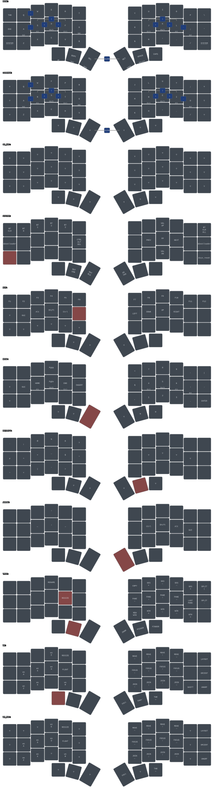

# zmk-config-corne42

ZMK firmware config for a 42-key Corne split keyboard on nice!nano controllers. It holds one
keymap, its combos, and the build targets that turn them into a firmware file for each half.

The behaviors the keymap binds are defined in
[zmk-shared](https://github.com/datapointchris/zmk-shared): home-row mods, thumb layer-taps,
Bluetooth tap-dances, and the window-manager and tmux macros. The Glove80 and Piantor configs
include that module too. A change to how a behavior acts belongs there. A change to which key binds
it belongs here. So does the rest of what is this Corne's own: its key positions, its layer order,
its combos, its OS switch and its build matrix. [zmk](https://github.com/datapointchris/zmk) is the
tool that builds, draws, checks and flashes it.

## Install

The firmware compiles inside ZMK's own Docker image. `zmk` drives that container.

```bash
# from your package manager: docker (runnable without sudo), yq (mikefarah's), python3, uv, fzf, and udisks2 on Linux
curl -fsSL https://raw.githubusercontent.com/datapointchris/zmk/main/install.sh | bash  # zmk, linked into ~/.local/bin
uv tool install keymap-drawer                                       # `keymap`, which renders the SVG
uv tool install git+https://github.com/datapointchris/keymap-align  # column-aligns the keymap
```

## Starting from scratch

`zmk` finds the shared module as a sibling directory named `shared`. The two clones sit side by
side.

```bash
mkdir -p ~/zmk && cd ~/zmk
git clone https://github.com/datapointchris/zmk-shared shared  # must be named shared, beside the config
git clone https://github.com/datapointchris/zmk-config-corne42 corne42
cd corne42

zmk check                                   # files, drawing, build targets, shared module, tools
zmk build                                   # fetches the west workspace once, then builds every target
zmk flash corne_choc_left corne_choc_right  # or the corne_mx pair; one half at a time
```

`zmk check` exits 1 on any error. It reports every missing file and tool in one run rather than
stopping at the first.

The first build fetches a west workspace of several gigabytes into `~/.cache/zmk/corne42/`. The
directory is named after the config checkout. Later builds are incremental. Each firmware lands in
the repo root as `<artifact-name>.uf2`, which git ignores.

`zmk flash` waits for a bootloader drive to appear, checks it for `INFO_UF2.TXT`, then copies the
file. Its prompt says to double-tap reset. That is the way in on a first flash. Once this keymap is
on the board, the bootloader is also a key. Hold SYSTEM, the outer key of the bottom row on either
side. Then press the outermost home-row key on the half being flashed: the key that is Esc on the
left, or `'` on the right. That key reboots the half it sits on, whichever hand holds SYSTEM. Each
half gets 60 seconds to appear. `ZMK_FLASH_TIMEOUT` changes that.

## Two keyboards, one keymap — the Choc and MX builds differ only in their Bluetooth name

```bash
zmk flash corne_choc_left corne_choc_right  # advertises itself as CorneChoc
zmk flash corne_mx_left corne_mx_right      # advertises itself as CorneMX
zmk flash settings_reset                    # erases one half's stored settings, its Bluetooth bonds included
```

`build.yaml` builds the same shields twice. The two pairs differ only in
`CONFIG_ZMK_KEYBOARD_NAME`, which is the name a host lists when it pairs. One host can pair both
keyboards and tell them apart. Flash whichever pair matches the board in hand. Both pairs raise
Bluetooth transmit power to +8 dBm through `cmake-args`.

`settings_reset` fits either keyboard. When the halves stop connecting to each other, flash it to
both. Then flash the firmware to both again. It erases every bond on the half, so each host pairs
afresh afterwards.

## Layers — a layer's number is its block's position in the keymap, not its define



| # | Layer | Reached by | Holds |
| --- | --- | --- | --- |
| 0 | BASE | default | QWERTY with home-row mods; Tab and Esc on the left edge, `\` and `'` on the right, Caps Word on the outer right thumb |
| 1 | COLEMAK | both inner thumbs together, as a toggle | Colemak-DH letters and their home-row mods; every other key falls through to BASE |
| 2 | SYSTEM | holding the outer key of the bottom row, on either side | Bluetooth profiles and clearing, USB or BLE output, the OS toggle, media, Ctrl+Alt+Del, bootloader and reset |
| 3 | NAV | holding G | F1–F12 across the top row, arrows on H J K L, plain modifiers on the left home row |
| 4 | NPAD | holding Delete on the inner left thumb | number pad on the right with 0 on the right thumbs; Home, End, Page Up, Page Down and Insert on the left |
| 5 | DEVLEFT | holding Space on the middle right thumb | programming symbols under the left hand; the right home-row mods fall through from BASE |
| 6 | ARROW | holding Enter on the inner right thumb | arrows on E S D F, modifiers on J K L ; |
| 7 | TMUX | holding Backspace on the middle left thumb | tmux panes, windows and sessions under the right hand |
| 8 | WM | holding the outer left thumb | window-manager chords: focus on H J K L, move on the row above, join on the row below, workspaces on left-hand letters |
| 9 | OS_MAC | toggled from SYSTEM | nothing; every key is transparent, and the layer is a flag |
| 10 | WM_MAC | holding WM while OS_MAC is on | the WM chords, sent on Alt |

Home-row mods run GASC from the pinky inward: GUI, Alt, Shift, Ctrl, mirrored on the right. On
the letter layers, Shift uses a faster variant than the other three.

The combos fire on BASE and COLEMAK alike. They are bound to positions, so they stay on the same
physical keys under either layout. Home-row pairs type brackets: S+D `[`, D+F `(`, S+F `{`, then
J+K `)`, K+L `]`, J+L `}`. A+S types `_`, L+; types `-`, and Q+W types `~`. Each combo needs 150 ms
of idle before it, so a pair pressed mid-word types both letters. The two inner thumbs together
toggle COLEMAK after 300 ms of idle.

Key positions run 0–11 along the top row across both halves, then 12–23 and 24–35 below it. The
thumbs are 36–41. `KEYS_L`, `KEYS_R`, `THUMBS_L` and `THUMBS_R` at the top of the keymap list them
per hand. They must be defined before `shared_behaviors.dtsi` is included, because every shared
hold-tap names them as its trigger positions. An 80-key board's positions do not carry over.

A layer's number comes from where its block sits in `keymap`. The `#define` at the top only names
that number. A layer inserted anywhere but last leaves every later define pointing at the wrong
block. Nothing errors.

## TMUX and ARROW — a thumb that opens a two-handed layer gates on both hands

A shared thumb layer-tap resolves as a hold only when the key pressed under it belongs to the other
hand. That gate stops a same-hand roll from opening a layer. It also decides which key may come
first, because any key outside the gate resolves the tap. ARROW holds arrows under the left hand
and modifiers under the right. TMUX holds Shift under the left hand and its actions under the
right. Both open on `ltltb` and `ltrtb`, which gate on every key except their own thumb cluster. On
a plain `ltlt`, pressing F first inside TMUX would type Backspace. The cost is that a tap can roll
into the layer from either hand.

TMUX sends finished chords and prefix macros, so every tmux action is the thumb and one key. NAV's
bare arrows would leave the left hand to add Ctrl or Ctrl+Shift. That makes the same action three
or four keys. A chord is bound directly wherever tmux reaches the action without its prefix,
because a chord repeats while held and a macro fires once per press. Each macro sends the prefix,
Ctrl+Space, then one key. Stock tmux uses Ctrl+B as its prefix and binds none of the chords. The
layer needs a tmux config that matches it.

F is Shift inside TMUX. Held with the thumb, it turns the Ctrl+arrow pane moves into
Ctrl+Shift+arrow, which a matching config binds to resize. It sits on F because the middle left
thumb is the layer key itself. Shift reaches the macros as well, so a macro pressed while F is held
arrives shifted.

## One firmware per half — the OS is switched on the keyboard, not at build time

Linux is the default. WM sends its chords through zmk-shared's `WMK()`, `WMSK()` and `WMCK()`
macros. `build.yaml` passes no `-DOS_MACOS`, so those resolve to Super, Super+Shift and
Super+Ctrl.

Holding SYSTEM and pressing the inner right thumb toggles OS_MAC. That layer is all transparent
keys and changes no key by itself. A conditional layer raises WM_MAC whenever WM and OS_MAC are
both on. WM_MAC sends the same chords on Alt, Alt+Shift and Alt+Ctrl+Shift, for AeroSpace. It has
to be numbered above WM, or WM's own chords win. WM's middle right thumb sends `LG(GRAVE)` on both
systems, because WM_MAC leaves that key transparent.

The toggle lives in RAM. A reset, a power cycle or a wake from deep sleep starts the board on Linux
again.

Every combo lists `OS_MAC_LAYER` in its `layers`. ZMK checks a combo against the highest active
layer alone. In macOS mode, that is the flag. Without the entry, no combo fires in macOS mode.
The flag also sits above SYSTEM, NAV, NPAD, DEVLEFT, ARROW and TMUX. So in macOS mode the combos
fire while one of those is held, too.

## Building — local builds see `../shared` live; CI sees only what is pushed

```bash
zmk sync              # align the keymap, redraw the SVG, build every target
zmk check             # after a keymap edit: does the drawing still match it?
zmk build --pristine  # after a cmake-args change, which the build cache would otherwise keep
zmk build --update    # run west update first, pulling upstream ZMK's current main
zmk --help            # every command
```

`zmk` bind-mounts the sibling `shared/` into the build container. An edit there reaches the next
local build with no commit. CI has no such mount. It resolves zmk-shared through `config/west.yml`,
from GitHub at `main`. A change spanning both repos therefore pushes zmk-shared first. Otherwise
the board's CI run compiles against a `main` that lacks the change. A fork that changes shared
behaviors points the `datapointchris` remote in `config/west.yml` at its own copy.

Every push and pull request builds on GitHub Actions, through upstream ZMK's reusable
`build-user-config.yml` workflow at `main`. Each run attaches one `firmware` artifact holding a
`.uf2` per `build.yaml` entry. A fork with no Docker can flash from that.

`corne_keymap.yaml`, the drawing's source, is written by hand. A keymap edit never reaches the
drawing by itself. The SVG still renders cleanly. `zmk check` is what notices. It compares
every cell by class: a key, transparent, or none. It also checks that each key holding a layer open
is labeled with that layer. Other labels are free text, so it does not compare them. `zmk sync`
redraws from the YAML without checking it.

`--pristine` wipes only the build directories. A bad CMake flag persists in their cache until then.
`zmk clean` is the heavier reset. It deletes this repo's firmware and its whole west workspace. The
next build fetches the workspace again.

## Hardware — upstream ZMK defines every board and shield it builds

`build.yaml` names the board `nice_nano//zmk`: the nice!nano with ZMK's `zmk` variant, which
defaults to the v2 revision. Each half adds the `corne_left` or `corne_right` shield and a nice!view
display through `nice_view_adapter nice_view`. None of these is defined here. So `config/west.yml`
tracks upstream `zmkfirmware/zmk` at `main`. CI builds against whatever `main` holds that day. A
local build keeps the workspace it fetched until `zmk build --update`.

The left half is the central. It runs the keymap and reaches the host over USB or Bluetooth. The
right half is a peripheral that reaches only the left, over Bluetooth. `config/corne.conf` applies
to both halves. `config/corne_left.conf` turns on USB and smooth scrolling.
`config/corne_right.conf` turns USB off.

The rest of `config/corne.conf` sets these:

- The board sleeps after two hours idle. A key press wakes it. The wake is a reboot.
- A press registers after 5 ms of stable contact, which is ZMK's default. A release takes 10 ms.
- `CONFIG_ZMK_BLE_EXPERIMENTAL_CONN` turns on ZMK's experimental connection settings, which turn
  off the 2M PHY for host compatibility.
- `CONFIG_BT_GATT_ENFORCE_SUBSCRIPTION` is off. Left on, a Windows battery-notification bug drops
  the connection.
- `CONFIG_ZMK_BLE_EXPERIMENTAL_SEC` stays off. It switches pairing to a passkey, which hangs on
  Linux's BlueZ.
- Pointing is on, with smooth scrolling on the central. No layer binds a pointing key.

## Beside the other configs — the Piantor shares the positions, not the board

[zmk-config-piantor-pro-bt](https://github.com/datapointchris/zmk-config-piantor-pro-bt) is the
nearest config. It numbers the same 42 positions the same way. It switches OS at runtime the same
way. Its controller is built into the board, so that repo carries its own board definition. It pins
a ZMK release tag rather than `main`. Its layers sit in a different order, so a layer number does
not carry across.

[zmk-config-glove80](https://github.com/datapointchris/zmk-config-glove80) is an 80-key board on
MoErgo's fork of ZMK. It fixes the OS at build time, with one firmware pair per OS. None of its
positions carry over.
